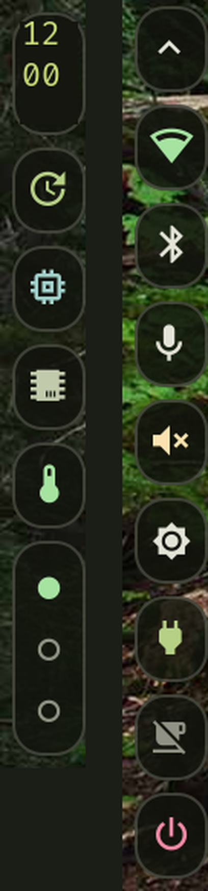

# fire-dotfiles

Quiet, minimal niri setup. It started from the stock Hyprland Garuda install and was pruned down to the essentials: a scrolling tiling desktop with almost nothing on screen.
One slim bar, no clutter, colours that follow the wallpaper.

**Principles:** less chrome, more space. Everything is plain text and reproducible. Light on battery, light on the eyes.

- **niri**: scrollable tiling, no floating decoration
- **Waybar**: a single slim vertical bar, icons only, no labels
- **matugen**: palette derived from the daily wallpaper
- **Calm boot**: Bing wallpaper on the login, boot and lock screens, no distro branding
- **Power**: TLP and amd-pstate tuned for battery
- **Unlock**: face unlock with Howdy

This repo is a **copy** of the live system, refreshed by `sync.sh`; it is not symlinked.

## Screenshots


Wallpaper blurred on purpose (copyrighted daily Bing image).



The bar at 2x, split in two: top group left, bottom group right. Status colours are fixed (red, green, yellow); the rest follows the wallpaper.

## Layout

```
home/       mirrors $HOME  (.config/..., .zshrc, .local/bin/...)
system/     mirrors /      (root-owned files: /etc, /usr/local/bin, themes)
sync.sh     refresh this repo from the running system
```

Personal values (git name/email, swap UUID) are replaced with placeholders by `sync.sh`.

## Update the backup

```
./sync.sh && git add -A && git status
git commit -m "..."
```

`sync.sh` copies only the lists inside it, sanitises personal values, and aborts if it finds an obvious
token, private key, or any string from a local, git-ignored `.private-patterns` file.

## Restore on a new machine

User files (backs up what it overwrites to `~/dotfiles-backup`):

```
rsync -a --backup --backup-dir="$HOME/dotfiles-backup" home/ "$HOME"/
```

System files: review each one first; they hold machine-specific values such as UUIDs and PCI paths.

```
sudo install -Dm644 system/etc/tlp.d/10-battery.conf /etc/tlp.d/10-battery.conf   # one file at a time
```

Then: `sudo systemctl enable --now sddm-bing.timer tlp` and `sudo grub-mkconfig -o /boot/grub/grub.cfg`.
Values to set by hand: the resume UUID in `/etc/default/grub`, the CPU `hwmon-path-abs` in
`waybar/modules.json`, the camera path in `/etc/howdy/config.ini`, monitor names in `~/.config/niri/config.kdl`,
and your git name/email in `~/.gitconfig`.

## Not in this repo

SSH keys and config, git private settings, tokens (`gh`, `rclone`), browser profiles, shell history,
Claude Code state, Howdy face models, fingerprints, auth cookies, editor buffers, and package lists.
